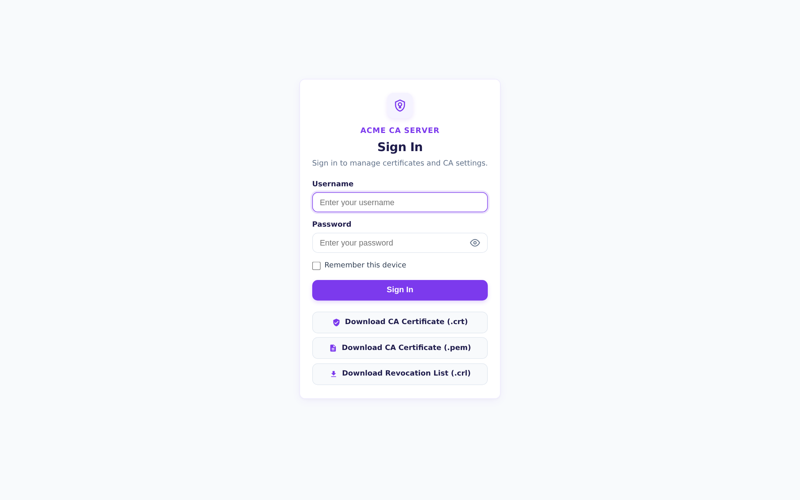
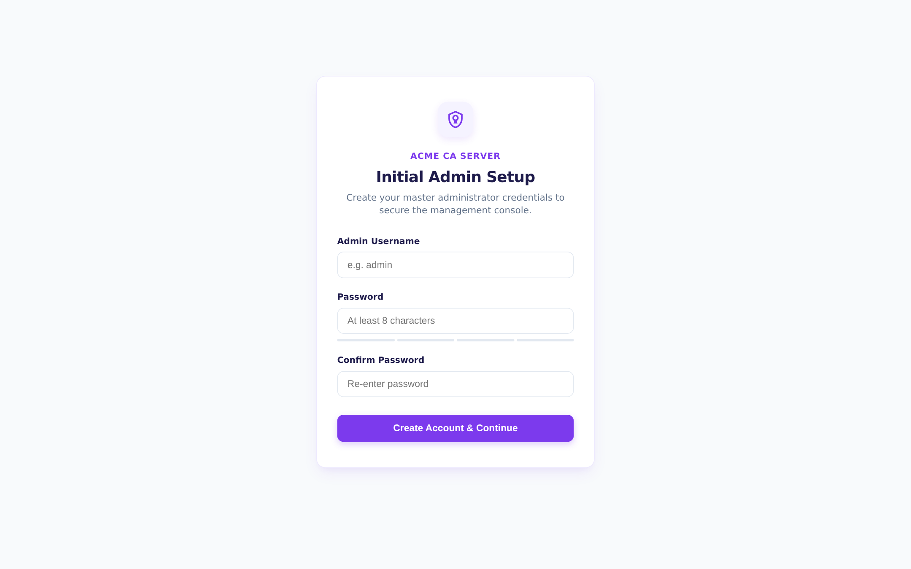
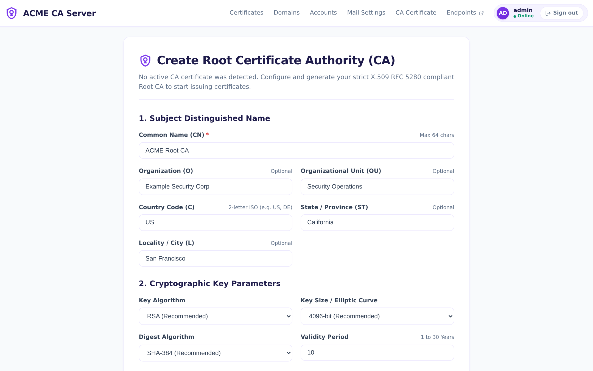
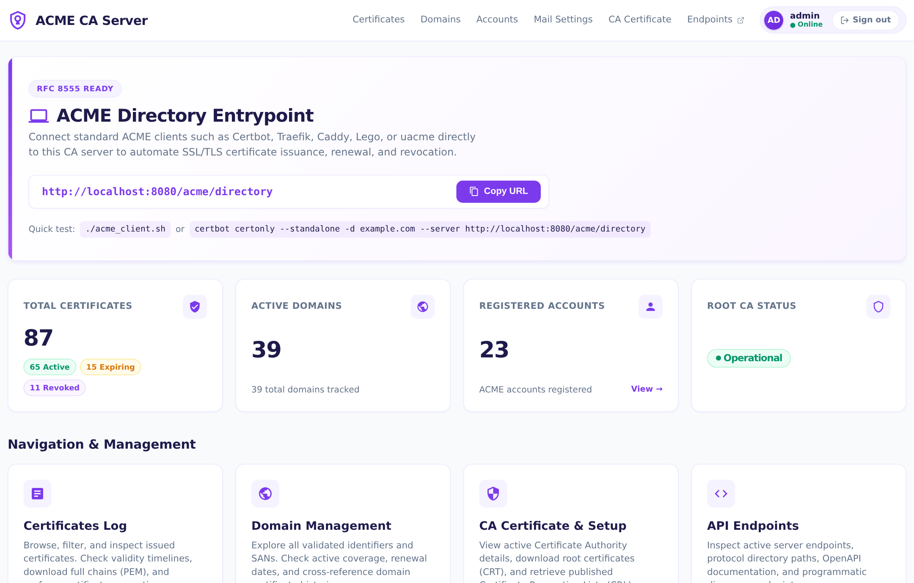
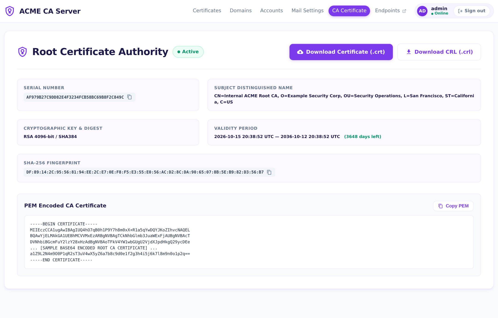
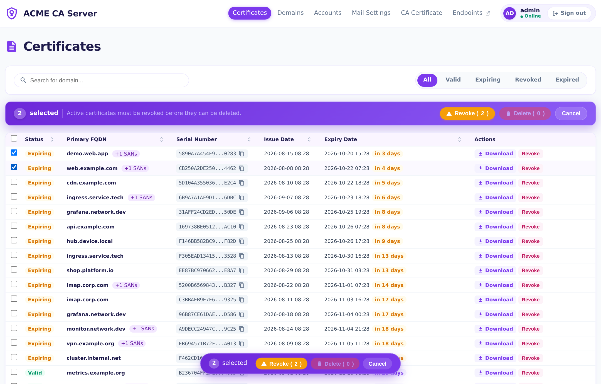
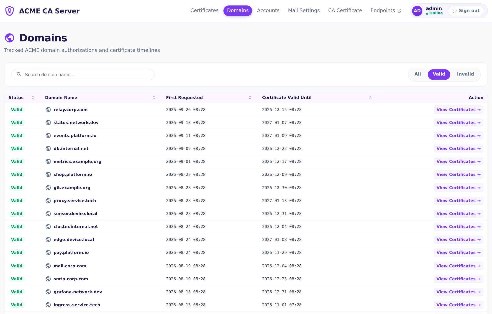
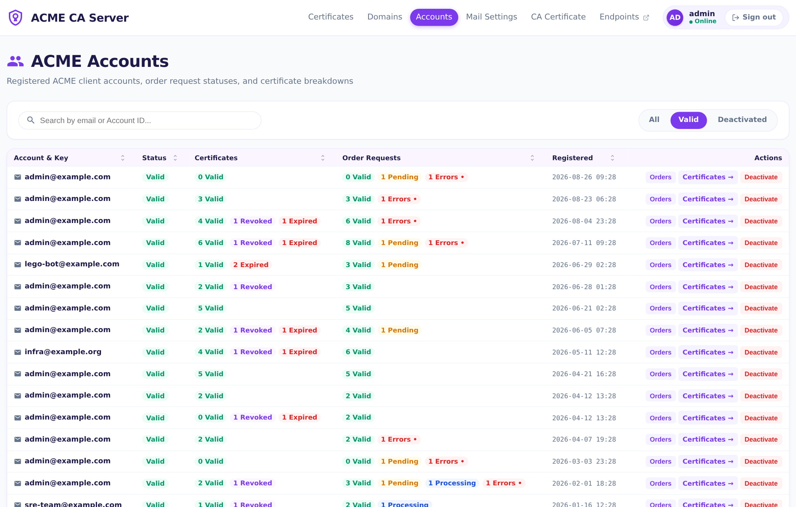
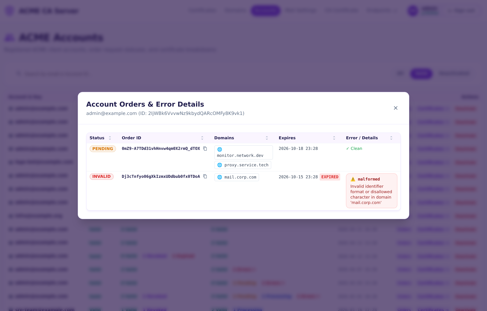
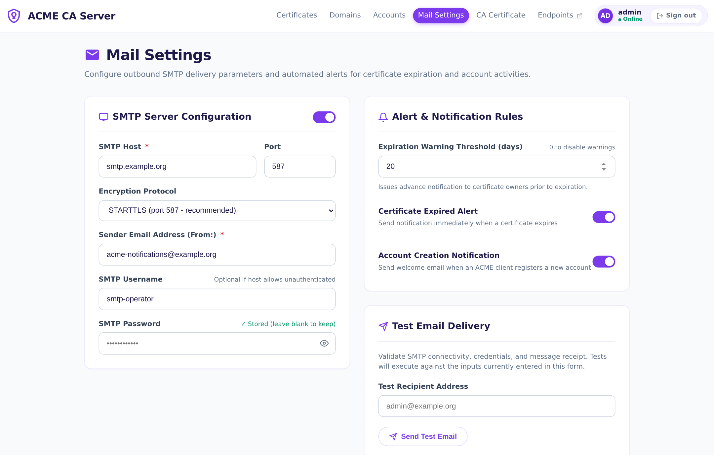

# ACME CA Server &mdash; UI Tour & Screen Showcase

Welcome to the visual documentation for **ACME CA Server**. This guide captures the entire web user experience, covering authentication, first-boot onboarding workflows, administrative management screens, and the updated accounts and order diagnostics views.

To re-generate or update these captures at any time, run:
```bash
./scripts/capture_ui_screens.py
```

---

## Table of Contents
1. [Authentication & Onboarding](#1-authentication--onboarding)
   - [01. Login Screen](#01-login-screen)
   - [02. Initial Admin Onboarding](#02-initial-admin-onboarding)
   - [03. Root CA Certificate Setup & Onboarding](#03-root-ca-certificate-setup--onboarding)
2. [Administrative Views & Audit Logs](#2-administrative-views--audit-logs)
   - [04. Home Dashboard](#04-home-dashboard)
   - [05. Root CA Certificate Details](#05-root-ca-certificate-details)
   - [06. Certificates Audit Log](#06-certificates-audit-log)
   - [07. Domains Registry](#07-domains-registry)
   - [08. Accounts Management](#08-accounts-management)
   - [09. Account Orders & Error Details Modal](#09-account-orders--error-details-modal)
   - [10. Mail Settings & Delivery Diagnostics](#10-mail-settings--delivery-diagnostics)

---

## 1. Authentication & Onboarding

### 01. Login Screen
The entry authentication gateway features a branded purple shield icon, floating credential inputs, persistent "Remember Me" session support, styled feedback alerts, and public one-click downloads for the active Root CA Certificate (in both `.crt` and `.pem` formats) alongside the Certificate Revocation List (`.crl`).



---

### 02. Initial Admin Onboarding
When running a clean instance without environment-seeded credentials, navigating to `/setup` prompts operators to initialize administrative credentials.



---

### 03. Root CA Certificate Setup & Onboarding
If the internal Certificate Authority has not yet been initialized, navigating to `/ca` or `/ca/setup` opens this guided configuration interface. Operators can define:
- **Distinguished Name Details**: Common Name, Organization, Country, State, Locality.
- **Cryptographic Settings**: Key Algorithm (RSA 2048/4096 or ECDSA curves P-256/P-384/P-521) and Hash Digest (SHA-256, SHA-384, SHA-512).
- **Validity Duration**: Configurable certificate validity in years.



---

## 2. Administrative Views & Audit Logs

### 04. Home Dashboard
The central operational overview for operators:
- **ACME Entrypoint Hero Card**: Instant one-click copy of the active ACME directory URL (`http://localhost:8080/directory` or configured external domain) for configuring Certbot, Caddy, Traefik, or the bundled bash test harness.
- **Live KPI Counter Cards**: Real-time totals for Valid Certificates, Monitored Domains, Active Accounts, and Pending Orders.
- **Quick Links**: Direct shortcuts to inspect certificates, domains, CA details, and accounts.



---

### 05. Root CA Certificate Details
The active Certificate Authority screen with a **40% left / 60% right** proportional layout:
- **Left Column (40%)**: Serial Number and Cryptographic Key & Digest.
- **Right Column (60%)**: Subject Distinguished Name and Validity Period countdown.
- **Full Width**: SHA-256 Fingerprint.
- **Download Buttons**: Immediate download of the active Root Certificate (`.crt`) and Certificate Revocation List (`.crl`).
- **PEM Viewer**: In-browser inspection and one-click copy of the raw PEM CA certificate.



---

### 06. Certificates Audit Log
Comprehensive log of all certificates issued by the ACME server:
- **Interactive Sortable Columns**: Multi-state 3-way cycle (Ascending ▲ ➔ Descending ▼ ➔ Original order ↕) for **Status**, **Primary FQDN**, **Serial Number**, **Issue Date**, and **Expiry Date**.
- **User-Resizable Columns**: Draggable border handles on all column headers (including **Actions**) with double-click reset and `localStorage` persistence.
- **Multi-Select & Batch Actions**: Select multiple certificates via checkboxes to perform **Batch Revoke** or **Batch Delete** with prominent top and floating action toolbars.
- **Revoked Certificate Deletion**: Revoked certificates can be permanently removed with an explicit confirmation dialog detailing the impact on the Certificate Revocation List (CRL).
- **State & Filter Preservation**: Actions (revocation, permanent deletion, batch revoke, batch delete) seamlessly preserve active tab filters (`certstatus`), search query (`domainfilter`), and account filters (`account_id`), preventing disruptive view resets.
- **Local Service Timezone Tooltips**: Issue and expiration timestamps display formatted in local service time, with hover tooltips rendering the precise second and timezone designation (`YYYY-MM-DD HH:MM:SS TZ`).
- **High-Density Expanded Layout**: Responsive 1560px max container with clean padding for enhanced visibility on widescreen displays.
- Filterable by status tabs: **All**, **Valid**, **Expiring**, **Revoked**, **Expired**.
- Real-time client-side text search by domain, common name, or serial number.
- Direct download of individual leaf certificates and certificate chains.
- Revocation management with confirmation dialog and CRL synchronization.



---

### 07. Domains Registry
Registry of all Fully Qualified Domain Names (FQDNs) managed by ACME clients:
- **Interactive Sortable Columns**: Sortable by **Status**, **Domain Name**, **First Requested**, and **Certificate Valid Until**.
- **User-Resizable Columns**: Interactive drag handles to adjust column widths with persistence across visits.
- **Cross-View Navigation**: The `View Certificates →` action links directly to `/certificates?domainfilter=<domain>&certstatus=all`, ensuring all matching leaf certificates are displayed regardless of the active status tab.
- **Safe Domain Deletion**: Allows safe deletion of invalid domains that no longer have associated active certificates, cleaning up old ACME authorizations, challenges, orders, and failure logs with modal confirmation and filter state retention.
- **Local Timezone Display**: First requested and validity timestamps feature hover tooltips detailing exact seconds and active server timezone.
- Status badges indicating domain validity.



---

### 08. Accounts Management
Management center for all registered ACME client accounts:
- **Interactive Sortable Columns**: Sortable by **Account & Key**, **Status**, **Certificates** count, **Order Requests** count, and **Registered** date.
- **User-Resizable Columns**: Draggable column resize handles with automatic minimum-width protection and `localStorage` persistence.
- **Dedicated Activation & Deactivation Confirmation Modals**: Purpose-built modal dialogs with visual accents and clear severity styling (Emerald Green for activation, Amber for deactivation) to prevent accidental status alterations.
- **Guarded Account Deletion**: Deactivated accounts without active certificates can be permanently deleted with confirmation, removing associated ACME orders, challenges, and error logs. Client and server-side safety checks dynamically disable deletion if valid certificates are tied to the account.
- **Preserved Filter Navigation**: Filter query strings (`accountstatus`, `accountfilter`) remain preserved upon status toggles and account deletion.
- Displays Account ID (`kid`), contact email, and public key type (RSA/ECDSA).
- Certificate breakdown counters: **Valid**, **Revoked**, and **Expired**.
- Order request breakdown counters: **Valid**, **Pending**, **Processing**, and **Errors**.



---

### 09. Account Orders & Error Details Modal
Triggered by clicking on the order error pill or the **Orders** button for any account:
- **Sortable & Resizable Data Table**: Rendered as a structured table with interactive 3-way sorting and draggable column width resizing.
- **Status & Order ID**: Instant status badges and one-click copy button for each ACME Order ID.
- **Domain Pills**: Lists all domain identifiers associated with each order request.
- **Clear Expiration Display**: Shows formatted timestamp (`YYYY-MM-DD HH:MM`) with real-time expired status badges.
- **Detailed Error Box**: Pinpoints validation failures (e.g., DNS NXDOMAIN, connection refused, unauthorized) directly from the underlying ACME challenges.
- **Frosted Glass Backdrop**: High-contrast modern modal overlay with frosted glass blur effect (`backdrop-filter: blur(5px)`).



---

### 10. Mail Settings & Delivery Diagnostics
Dedicated management interface for outbound email delivery and automated notification policies:
- **SMTP Server Configuration**: Full control over outbound delivery with toggle switch, Host, Port, Encryption protocol (`STARTTLS`, `SSL/TLS`, `Plain`, and non-strict certificate modes with automatic port suggestions), Sender Address (`From:`), and credentials.
- **Secure Password Handling**: Masked password field with show/hide eye toggle that safely preserves existing credentials if left blank during updates.
- **Alert & Notification Rules**: Configurable advance expiration warning threshold (in days, set to 0 to disable), toggle for certificate expiration alerts, and toggle for account registration notifications.
- **Live Connection & Delivery Test**: Interactive "Send Test Email" test suite that runs via AJAX against current form inputs before saving, displaying immediate real-time diagnostics (success confirmation, connection refusal, authentication rejection, or SSL/TLS handshake errors).




