# ACME CA Server &mdash; UI Tour & Screen Showcase

Welcome to the visual documentation for **ACME CA Server**. This guide captures the entire web user experience, covering authentication, first-boot onboarding workflows, administrative management screens, and the updated accounts and order diagnostics views.

To re-generate or update these captures at any time, run:
```bash
./scripts/capture_ui_screens.py
```

---

## Table of Contents
1. [Authentication & Onboarding](#1-authentication--onboarding)
   - [01. Login Screen](#01-login-screen)
   - [02. Initial Admin Onboarding](#02-initial-admin-onboarding)
   - [03. Root CA Certificate Setup & Onboarding](#03-root-ca-certificate-setup--onboarding)
2. [Administrative Views & Audit Logs](#2-administrative-views--audit-logs)
   - [04. Home Dashboard](#04-home-dashboard)
   - [05. Root CA Certificate Details](#05-root-ca-certificate-details)
   - [06. Certificates Audit Log](#06-certificates-audit-log)
   - [06b. Certificate Details & Capability Inspection Modal](#06b-certificate-details--capability-inspection-modal)
   - [07. Domains Registry](#07-domains-registry)
   - [08. Accounts Management](#08-accounts-management)
   - [09. Account Orders & Error Details Modal](#09-account-orders--error-details-modal)
   - [10. Mail Settings & Delivery Diagnostics](#10-mail-settings--delivery-diagnostics)
   - [11. User Management & Access Control](#11-user-management--access-control)
   - [12. CA Certificate Distribution Hub](#12-ca-certificate-distribution-hub)
   - [12b. Root CA Certificate Deployment & Distribution Modal](#12b-root-ca-certificate-deployment--distribution-modal)
   - [13. CA Fleet Trust & Compliance Audit](#13-ca-fleet-trust--compliance-audit)
   - [13b. CA Fleet Trust CLI Probe Commands Modal](#13b-ca-fleet-trust-cli-probe-commands-modal)
   - [14. Client Root CA Trust Verification Portal](#14-client-root-ca-trust-verification-portal)
   - [15. Data Management & Automated Retention](#15-data-management--automated-retention)
   - [15b. Data Retention Dry-Run & Simulation Modal](#15b-data-retention-dry-run--simulation-modal)
   - [16. API Trace Live Diagnostic Grid](#16-api-trace-live-diagnostic-grid)
   - [16b. API Trace Payload & Base64 Decoding Modal](#16b-api-trace-payload--base64-decoding-modal)
   - [16c. API Trace X.509 CSR Decoding Modal](#16c-api-trace-x509-csr-decoding-modal)

---

## 1. Authentication & Onboarding

### 01. Login Screen
The entry authentication gateway features a branded purple shield icon, floating credential inputs, persistent "Remember Me" session support, styled feedback alerts, public one-click downloads for the active Root CA Certificate (in both `.crt` and `.pem` formats) alongside the Certificate Revocation List (`.crl`), and consistent release version pill and GitHub repository links in the footer.


---

### 02. Initial Admin Onboarding
When running a clean instance without environment-seeded credentials, navigating to `/setup` prompts operators to initialize administrative credentials.


---

### 03. Root CA Certificate Setup & Onboarding
If the internal Certificate Authority has not yet been initialized, navigating to `/ca` or `/ca/setup` opens this guided configuration interface. Operators can define:
- **Distinguished Name Details**: Common Name, Organization, Country, State, Locality.
- **Cryptographic Settings**: Key Algorithm (RSA 2048/4096 or ECDSA curves P-256/P-384/P-521) and Hash Digest (SHA-256, SHA-384, SHA-512).
- **Validity Duration**: Configurable certificate validity in years.


---

## 2. Administrative Views & Audit Logs

### 04. Home Dashboard
The central operational overview for operators, structured logically to mirror administrative workflows:
- **ACME Entrypoint Hero Card**: Instant one-click copy of the active ACME directory URL (`http://localhost:8080/directory` or configured external domain) for configuring Certbot, Caddy, Traefik, or the bundled bash test harness.
- **Live KPI Counter Cards**: Reordered to prioritize entities: **Registered Accounts**, **Active Domains**, **Total Certificates**, and **Root CA Status** (featuring real-time X.509 Strict Compliance pill).
- **Navigation Feature Cards**: Ordered directly as **Accounts Management**, **Domain Management**, **Certificate Management**, **CA Setup & Diagnostics**, and **ACME Directory Endpoints**.


---

### 05. Root CA Certificate Details
The active Certificate Authority screen with a **40% left / 60% right** proportional layout:
- **Header Status Pills**: Harmonized 32px height status pills for **Active** and **X.509 Strict Compliant** (evaluating RFC 5280 Key Usage, critical Basic Constraints, Subject Key Identifier, time ranges, and hash strength).
- **Interactive Compliance Diagnosis Banner**: Clicking the X.509 Strict pill toggles an in-depth audit diagnosis banner listing all RFC 5280 compliance checks and issues.
- **Left Column (40%)**: Serial Number and Cryptographic Key & Digest.
- **Right Column (60%)**: Subject Distinguished Name and Validity Period countdown.
- **Full Width**: SHA-256 Fingerprint.
- **Download Buttons**: Immediate download of the active Root Certificate (`.crt`) and Certificate Revocation List (`.crl`).
- **PEM Viewer**: In-browser inspection and one-click copy of the raw PEM CA certificate.


---

### 06. Certificates Audit Log
Comprehensive log of all certificates issued by the ACME server:
- **Sticky Frozen Table Headers**: Header columns stay anchored at the top of the grid viewport during vertical scrolling, ensuring column titles and sort triggers remain immediately accessible across large certificate catalogs.
- **Column Visibility & 1-Click Reset**: An interactive column selector dropdown (`[Columns ⚙️]`) allows operators to show or hide individual columns, paired with a 1-click `[Reset]` control to restore default column widths and visibility.
- **Viewport-Locked Clean Layout**: Scoped viewport locking eliminates redundant nested page scrollbars, confining scrolling cleanly within the table container.
- **Details Inspection Action**: A dedicated "Details" action button on the far left of each row that opens the in-depth Certificate Details Inspection Modal.
- **Interactive Sortable Columns**: Multi-state 3-way cycle (Ascending ▲ ➔ Descending ▼ ➔ Original order ↕) for **Status**, **Primary FQDN**, **Serial Number**, **Issue Date**, and **Expiry Date**.
- **User-Resizable Columns**: Draggable border handles on all column headers (including **Actions**) with double-click reset and `localStorage` persistence.
- **Multi-Select & Batch Actions**: Select multiple certificates via checkboxes to perform **Batch Revoke** or **Batch Delete** with prominent top and floating action toolbars.
- **Revoked Certificate Deletion**: Revoked certificates can be permanently removed with an explicit confirmation dialog detailing the impact on the Certificate Revocation List (CRL).
- **State & Filter Preservation**: Actions (revocation, permanent deletion, batch revoke, batch delete) seamlessly preserve active tab filters (`certstatus`), search query (`domainfilter`), and account filters (`account_id`), preventing disruptive view resets.
- **Local Service Timezone Tooltips**: Issue and expiration timestamps display formatted in local service time, with hover tooltips rendering the precise second and timezone designation (`YYYY-MM-DD HH:MM:SS TZ`).
- **High-Density Expanded Layout**: Responsive 1560px max container with clean padding for enhanced visibility on widescreen displays.
- Filterable by status tabs: **All**, **Valid**, **Expiring**, **Revoked**, **Expired**.
- **Dynamic Search Filter & Count Badges**: Real-time client-side search input filtering across domains, Common Names, and serial numbers, accompanied by an instant dynamic counter badge reflecting filtered matches (`Showing X of Y`).
- Direct download of individual leaf certificates and certificate chains.
- Revocation management with confirmation dialog and CRL synchronization.


---

### 06b. Certificate Details & Capability Inspection Modal
Clicking the certificate icon (**Details**) on the far left of any certificate row opens an interactive, native `<dialog>` inspection modal that performs deep analysis of the issued leaf certificate:
- **Status Ribbon**: Active/Expiring/Expired/Revoked status pill badge, validity timeline with dynamic color-coded percentage progress bar, and days remaining countdown.
- **"What It Can Be Used For" (Capabilities Grid)**: Colorful, iconised capability cards parsed directly from X.509 Key Usage and Extended Key Usage extensions:
  - 🌐 **TLS / HTTPS Web Server**: Server Authentication (RFC 5280) for securing web servers, microservices, and APIs.
  - 🔒 **TLS Client Authentication (mTLS)**: Zero-trust machine and mutual-TLS service authentication.
  - 🛡️ **Code Signing**: Verifying binaries and package publisher identity.
  - ✉️ **Secure Email (S/MIME)**: Cryptographically signing and encrypting email messages.
  - 🔏 **Digital Signatures & Integrity**: Authenticity and non-repudiation.
- **Covered Hostnames & Domains (SANs)**: Interactive chip badges showing all hostnames and wildcard patterns covered by the Subject Alternative Names extension.
- **Health & Security Audit**: Real-time evaluation banner that audits against CRL revocation status, expiration windows, weak RSA key lengths (< 2048-bit), or missing CN in SANs, displaying a prominent green checkmark when all security audits pass.
- **Cryptographic Specifications**: Key Algorithm & Size (e.g. RSA 2048-bit, ECDSA P-256), Signature Hash Algorithm, Issuer CA, Issued Date, Expiration Date, Associated Account ID, and full SHA-256 Fingerprint with 1-click clipboard copy.
- **Direct Chain Download**: One-click download button for the active PEM certificate chain.

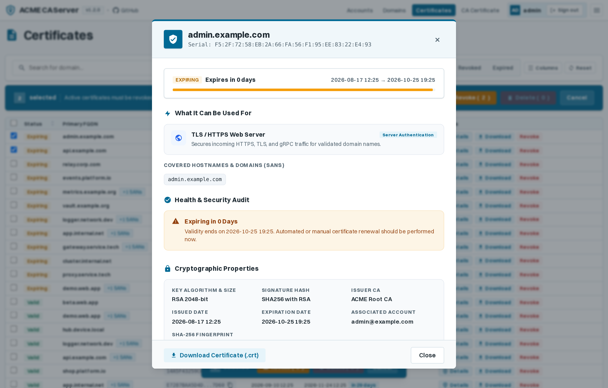

---

### 07. Domains Registry
Registry of all Fully Qualified Domain Names (FQDNs) managed by ACME clients:
- **Sticky Frozen Table Headers**: Table header remains firmly pinned at the top during vertical scrolling through domain lists.
- **Column Visibility & Reset Controls**: Dynamic `[Columns ⚙️]` dropdown to toggle column visibility and `[Reset]` button to restore standard column widths and visibility defaults.
- **Viewport-Locked View**: Eliminates duplicate outer page scrollbars for a clean, application-like experience.
- **Interactive Sortable Columns**: Sortable by **Status**, **Domain Name**, **First Requested**, and **Certificate Valid Until**.
- **User-Resizable Columns**: Interactive drag handles to adjust column widths with persistence across visits.
- **Cross-View Navigation**: The `View Certificates →` action links directly to `/certificates?domainfilter=<domain>&certstatus=all`, ensuring all matching leaf certificates are displayed regardless of the active status tab.
- **Safe Domain Deletion**: Allows safe deletion of invalid domains that no longer have associated active certificates, cleaning up old ACME authorizations, challenges, orders, and failure logs with modal confirmation and filter state retention.
- **Root CA Coverage Micro-Badges & Status**: Visual micro-badges (`🛡️ S`) indicate which internal Certificate Authority issued active leaf certificates for the domain, providing instant visibility into fleet coverage and highlighting orphaned or uncovered domains.
- **Dynamic Search Filter & Count Badges**: Real-time client-side search input accompanied by an instant dynamic counter badge displaying the exact count of filtered domains (`Showing X of Y`).
- **Local Timezone Display**: First requested and validity timestamps feature hover tooltips detailing exact seconds and active server timezone.
- Status badges indicating domain validity.


---

### 08. Accounts Management
Management center for all registered ACME client accounts:
- **Sticky Frozen Table Headers**: Grid headers remain visible when scrolling through accounts.
- **Column Visibility & Reset Controls**: Built-in `[Columns ⚙️]` menu and `[Reset]` action for personalized column arrangements with `localStorage` persistence.
- **Viewport-Locked View**: Dedicated single-scroll container without unnecessary outer page scrolling.
- **Interactive Sortable Columns**: Sortable by **Account & Key**, **Status**, **Certificates** count, **Order Requests** count, and **Registered** date.
- **User-Resizable Columns**: Draggable column resize handles with automatic minimum-width protection and `localStorage` persistence.
- **Dedicated Activation & Deactivation Confirmation Modals**: Purpose-built modal dialogs with visual accents and clear severity styling (Emerald Green for activation, Amber for deactivation) to prevent accidental status alterations.
- **Guarded Account Deletion**: Deactivated accounts without active certificates can be permanently deleted with confirmation, removing associated ACME orders, challenges, and error logs. Client and server-side safety checks dynamically disable deletion if valid certificates are tied to the account.
- **Preserved Filter Navigation**: Filter query strings (`accountstatus`, `accountfilter`) remain preserved upon status toggles and account deletion.
- **Dynamic Search Filter & Count Badges**: Real-time client-side search input supporting instant search across Account IDs (`kid`) and contact emails, paired with an active dynamic counter badge showing matching records (`Showing X of Y`).
- Displays Account ID (`kid`), contact email, and public key type (RSA/ECDSA).
- Certificate breakdown counters: **Valid**, **Revoked**, and **Expired**.
- Order request breakdown counters: **Valid**, **Pending**, **Processing**, and **Errors**.


---

### 09. Account Orders & Error Details Modal
Triggered by clicking on the order error pill or the **Orders** button for any account:
- **Sortable & Resizable Data Table**: Rendered as a structured table with interactive 3-way sorting and draggable column width resizing.
- **Multi-Select & Batch Deletion**: Select one or more orders via row checkboxes or the "Select All" header toggle. A prominent batch action bar (`Delete Selected (N)`) appears dynamically when entries are selected.
- **Active Certificate Protection**: Orders with active, valid certificates automatically disable selection with an explanatory hover tooltip to prevent accidental deletion of valid credentials.
- **Explicit Confirmation Dialog**: Displays a dedicated deletion confirmation dialog with warning alerts and a preview of selected order IDs and domain scopes.
- **In-Place Dynamic Updates & Smart Refresh**: Deleted orders are smoothly animated out and removed from internal client-side state with immediate counter updates. When the modal is closed, the Accounts list automatically refreshes if any deletions took place.
- **Status & Order ID**: Instant status badges and one-click copy button for each ACME Order ID.
- **Domain Pills**: Lists all domain identifiers associated with each order request.
- **Clear Expiration Display**: Shows formatted timestamp (`YYYY-MM-DD HH:MM`) with real-time expired status badges.
- **Detailed Error Box**: Pinpoints validation failures (e.g., DNS NXDOMAIN, connection refused, unauthorized) directly from the underlying ACME challenges.
- **Frosted Glass Backdrop**: High-contrast modern modal overlay with frosted glass blur effect (`backdrop-filter: blur(5px)`).


---

### 10. Mail Settings & Delivery Diagnostics
Dedicated management interface for outbound email delivery and automated notification policies:
- **SMTP Server Configuration**: Full control over outbound delivery with toggle switch, Host, Port, Encryption protocol (`STARTTLS`, `SSL/TLS`, `Plain`, and non-strict certificate modes with automatic port suggestions), Sender Address (`From:`), and credentials.
- **Secure Password Handling**: Masked password field with show/hide eye toggle that safely preserves existing credentials if left blank during updates.
- **Alert & Notification Rules**: Configurable advance expiration warning threshold (in days, set to 0 to disable), toggle for certificate expiration alerts, and toggle for account registration notifications.
- **Live Connection & Delivery Test**: Interactive "Send Test Email" test suite that runs via AJAX against current form inputs before saving, displaying immediate real-time diagnostics (success confirmation, connection refusal, authentication rejection, or SSL/TLS handshake errors).


---

### 11. User Management & Access Control
Dedicated administrative portal (`/users`) for user lifecycle management, authentication modes, and identity federation:
- **Unified Single-Line Toolbar**: Search query input, `+ Add User` button, `[Columns ⚙️]` dropdown, and `[Reset]` action are streamlined directly onto a single line beside the Registered Accounts table header.
- **Sticky Frozen Table Headers**: Keeps column headers pinned at the top while scrolling vertically through user accounts.
- **Viewport-Locked View**: Dedicated single-scroll container without redundant page scrollbars.
- **Account Type Differentiation**: Visual badges clearly differentiating between standard Local Accounts (purple shield icon) and OpenID Connect (OIDC) Single Sign-On users (blue globe icon).
- **Guided User Creation Modal**: Interactive dialog to onboard new local operators (with automatic PBKDF2 password hashing) or pre-provision federated OIDC identity providers (Authelia, Keycloak, Authentik).
- **Password Administration & Self-Service**: Direct modal dialogs for administrators to reset credentials, with live password confirmation validation.
- **Critical Deletion Safeguards**: Built-in safeguards that disable deletion of currently active sessions and prevent removing the last remaining local administrator account.
- **Audit Details**: Shows username, email address, registration timestamp, last login date, and authentication provider.

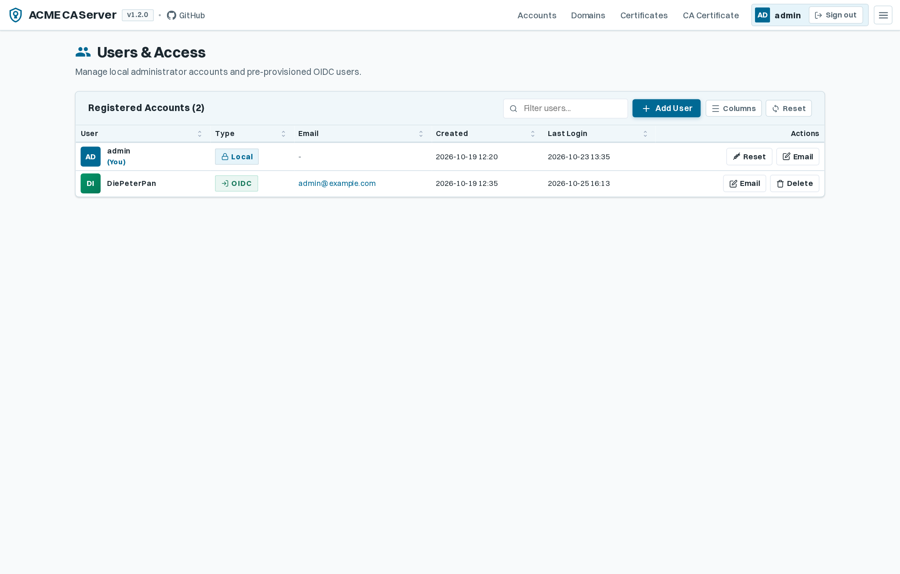

---

### 12. CA Certificate Distribution Hub
Centralized fleet orchestration interface (`/ca-distribution`) for automated certificate delivery across heterogeneous network infrastructure and servers:
- **Tab-Contextual Action Placement**: The `+ Add SSH Endpoint` and `+ Add Email Endpoint` action buttons are positioned directly inside their respective tab's grid toolbar immediately to the left of the `[Columns ⚙️]` and `[Reset]` controls.
- **Sticky Frozen Table Headers**: Table header rows remain anchored in place during vertical scrolling across both SSH Endpoints and Email Endpoints data tables.
- **Viewport-Locked Clean Layout**: Outer page scrollbars are eliminated, keeping table scrolling intuitive and self-contained within the view.
- **Dual Delivery Channels**: High-contrast tabbed management switching between **SSH / SCP Endpoints** and **Email Distribution Groups**, accompanied by real-time KPI counter badges.
- **Intelligent Remote OS Auto-Detection**: Live SSH probe engine (`uname`, `/etc/os-release`, `sw_vers`, `cmd.exe /c ver`) that identifies remote platforms (Ubuntu, Debian, RHEL, CentOS, Fedora, Alpine, Arch Linux, OpenWrt routers, macOS Darwin, and Windows Server 2016/2019/2022/10/11 with exact build mapping).
- **Platform-Tailored Installation Bundles**: Automatically generates OS-specific `README.txt` installation instructions (e.g. `update-ca-certificates`, `certutil.exe -addstore`, `security add-trusted-cert`, OpenWrt `/etc/ssl/certs/`) transferred alongside sanitized `.crt`, `.pem`, and `.cer` certificate formats.
- **Encrypted Credential Protection**: Remote SSH passwords and private keys are encrypted at rest using Fernet symmetric cryptography (`CA_ENCRYPTION_KEY`).
- **Interactive Connection & Diagnostics Testing**: Real-time AJAX test buttons that execute end-to-end handshakes, directory permission checks, or SMTP validation before deployment.
- **Distribution History & Audit Logs**: Detailed audit table logging every distribution run with timestamp, destination endpoint, certificate serial number, formatted filename, status badges, and expandable response detail popovers.

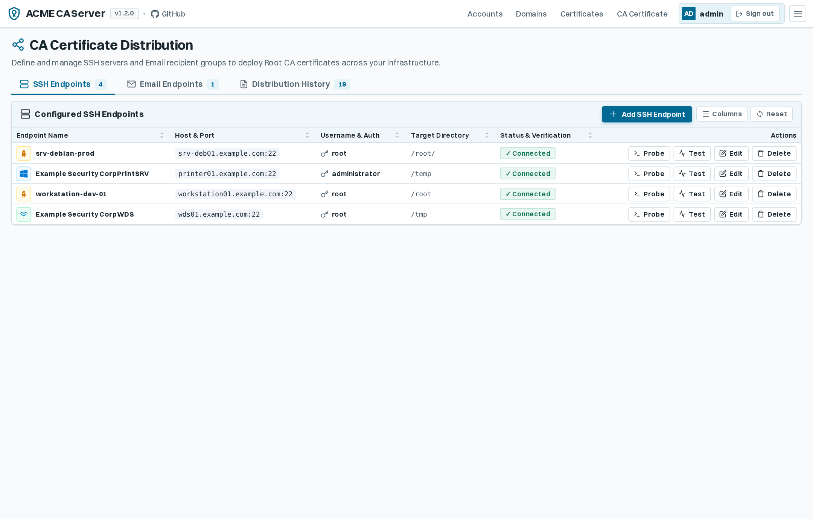

---

### 12b. Root CA Certificate Deployment & Distribution Modal
Direct distribution workflow triggered by clicking **Distribute** from the active Root CA Certificate screen (`/ca`):
- **Immediate Deployment Modal**: High-contrast modal overlay with backdrop blur showing the active CA Common Name, Subject DN, and validity period.
- **Multi-Endpoint Target Selection**: Interactive data table with row selection checkboxes, "Select All" header toggle, and live selected count counter.
- **Comprehensive Target Metadata**: Renders destination types (SSH server vs. Email group), hostnames, target directory paths, recipient counts, and operating system tags.
- **One-Click Batch Execution**: Dispatches certificate packages across all selected infrastructure targets simultaneously with real-time delivery status feedback.

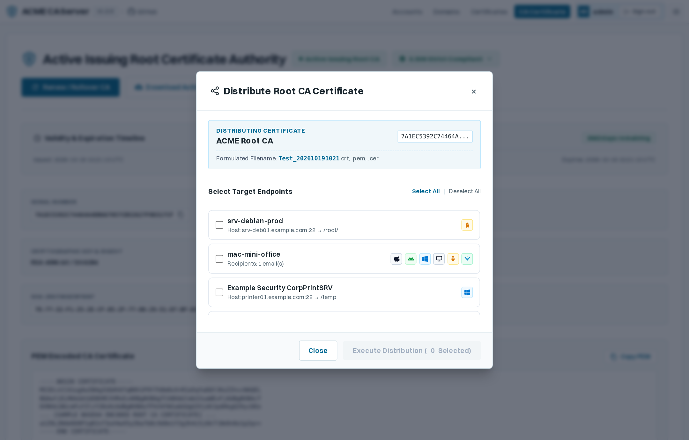

---

### 13. CA Fleet Trust & Compliance Audit
Centralized fleet compliance and trust propagation tracking dashboard (`/ca-fleet-trust`) providing real-time visibility into root certificate installation across heterogeneous network infrastructure:
- **Collapsible KPI Overview**: Features an interactive `[▾ Hide Overview] / [▸ Show Overview]` toggle button that smoothly collapses the upper KPI metric cards and actions section to maximize vertical viewport space for the device audit grid, persisting operator preference across visits via `localStorage`.
- **Sticky Frozen Table Headers & Natural Page Scrolling**: Preserves smooth natural page scrolling for multi-section visibility while pinning the device table's header row when scrolling through audit records.
- **KPI Summary Metrics**: Real-time counter cards detailing **Audited Endpoints**, **Compliant (Full Trust)**, **Partially Compliant**, **Untrusted / Missing**, and the computed overall **Fleet Trust Compliance Rate**.
- **Automated Fleet SSH Sweeps**: One-click execution (`Run Fleet Audit Sweep`) that connects to all configured CA distribution endpoints via SSH, inspects remote certificate directories (such as `/usr/local/share/ca-certificates`, `/etc/ssl/certs/`, and Windows Certificate Stores), and verifies certificate validity and bundle presence.
- **Real-Time SSE Sweep Progress**: Live Server-Sent Events streaming modal (`/ca-fleet-trust/sweep/stream`) that animates target-by-target inspection progress without requiring manual page reloads.
- **Reverse DNS & Endpoint Auto-Matching**: Automatically correlates incoming client telemetry and IP addresses to known CA distribution endpoints, displaying matching target badges directly in the audit log.
- **Multi-Parameter Audit Filter**: Search and filter by target Certificate Authority (Active vs. Standby), compliance status (`All`, `Compliant`, `Partial`, `Untrusted`), operating system (`Linux`, `OpenWrt`, `Windows`, `macOS`, `iOS`, `Android`), or free-form text search.
- **Device Audit Log Table**: Comprehensive audit history displaying Device Name, Matched Endpoint, IP Address, OS & User-Agent, Active CA Trust status badge, Standby CA Trust status badge, Overall Status, and Last Sweep timestamp with hover tooltips.

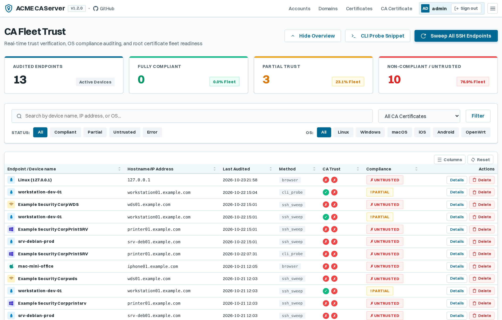

---

### 13b. CA Fleet Trust CLI Probe Commands Modal
Triggered by clicking **CLI Probes** (`#openCliProbeModal`) in the CA Fleet Trust header:
- **Automated Headless Shell One-Liners**: Provides zero-dependency, one-liner probe scripts (`curl -sSL .../ca-trust/probe.sh | sh`) for automated terminal execution across Linux, OpenWrt, and macOS endpoints.
- **Dedicated TLS Port Listeners**: Lists active and standby CA probe listener ports (e.g., ports 9443 and 9444) for validating certificate chains without touching web application ports.
- **Instant Clipboard Actions**: One-click copy buttons for POSIX shell, OpenWrt `uclient-fetch`, and PowerShell snippets for seamless inclusion in configuration management scripts (Ansible, Cloud-Init, CI/CD).
- **Audit Detail Inspection Modal**: Direct row action to inspect raw TLS handshake diagnostics, verified certificate fingerprints, and remote SSH sweep responses per device.

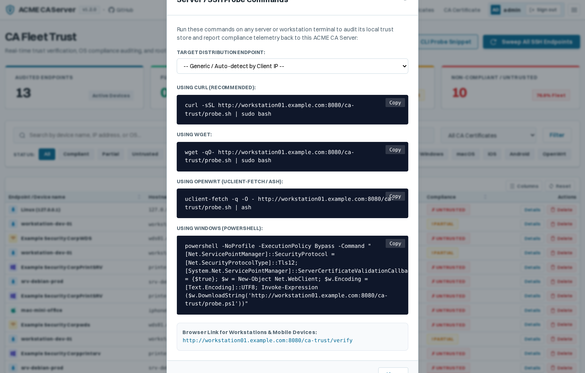

---

### 14. Client Root CA Trust Verification Portal
A dedicated, responsive self-service verification interface (`/ca-trust/verify`) designed for end-users, mobile devices, and workstations:
- **Automatic Client OS & Platform Detection**: Automatically identifies client user-agents (Apple iOS, Android, Apple macOS, Microsoft Windows, Linux) and displays platform-specific device branding.
- **Dedicated TLS Probe Handshake**: Executes real-time HTTPS handshakes against dedicated per-CA probe listener ports to test whether the device or browser natively trusts the internal Root CA.
- **Live Visual Compliance Indicators**: High-contrast status badges (Emerald Green for **Trusted**, Amber for **Partial**, Red for **Untrusted**) rendered per active and standby CA certificate.
- **Platform-Tailored Remediation Guidance**: Context-sensitive installation and trust-enablement steps:
  - **Apple iOS**: Step-by-step guidance for installing the configuration profile and enabling the crucial toggle under *Settings &rarr; General &rarr; About &rarr; Certificate Trust Settings*.
  - **Android**: Instructions for installing CA certificates via *Settings &rarr; Security &rarr; Encryption &amp; credentials*.
  - **macOS**: Detailed steps for importing and setting *Always Trust* in *Keychain Access*.
  - **Windows & Linux**: Native certificate store installation commands.
- **Direct CA Download**: Prominent 1-click download button for the active Root CA Certificate (`.crt`).
- **Telemetry Auto-Reporting**: Automatically logs successful and failed verification checks back to the server, feeding real-time device trust metrics directly into the administrative CA Fleet Trust dashboard.

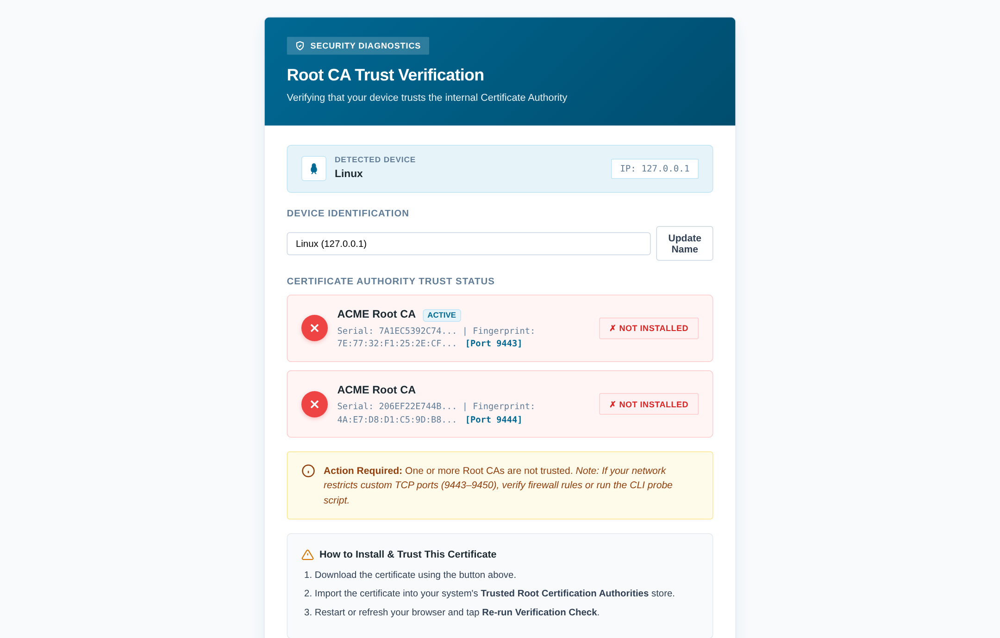

---

### 15. Data Management & Automated Retention
Centralized database retention and automated storage maintenance interface (`/data-management`):
- **Automated Retention Rule Engine**: Granular day threshold settings (with `0` to disable) across 8 core retention rules:
  - **Deactivated Accounts**: Purges deactivated accounts older than the threshold while safely protecting accounts with active valid certificates.
  - **Inactive & Expired Orders**: Prunes stale orders without associated active certificates.
  - **Invalid Domain Records**: Cleans up abandoned domain authorizations and orphaned challenges where linked certificates have expired or been revoked.
  - **Revoke Expired Certificates**: Automatically transitions expired leaf certificates to revoked status and syncs the active Certificate Revocation List (CRL).
  - **Delete Revoked Certificates**: Permanently purges revoked certificates older than the retention threshold and updates the CRL without them.
  - **CA Distribution Logs**: Prunes historical delivery records while always preserving the single latest log per endpoint.
  - **Fleet Trust Audit History**: Prunes device audit logs while retaining the most recent probe result per (Device, IP, Verification Method).
  - **Maintenance Run History**: Cleans up older audit records while preserving the 15 most recent maintenance sweeps.
- **Background Cronjob Scheduling**: Configurable automated scheduler running at custom intervals (e.g., every 24 hours) with preferred UTC execution hour.
- **Email Summary Reporting**: Dispatches comprehensive HTML maintenance reports to administrators with a "Notify Only on Changes" toggle to avoid empty notification clutter.
- **Dry-Run Audit Simulation**: Instant one-click simulation (`[Dry Run Audit]`) executing all active retention rules in read-only mode to preview affected record counts without modifying or deleting data.
- **Maintenance Run Audit Log**: Complete history table logging each execution timestamp, trigger type (Cron vs. Manual), status, duration in milliseconds, total records impacted, and popovers with granular per-rule breakdowns.

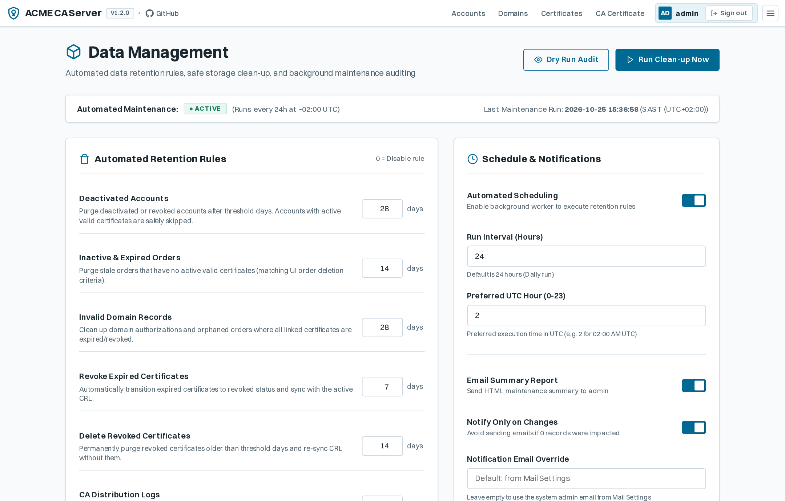

---

### 15b. Data Retention Dry-Run & Simulation Modal
Interactive simulation dialog triggered by clicking **Dry Run Audit** or **Run Clean-up Now**:
- **Real-Time Simulation Execution**: Executes retention evaluation asynchronously with animated loading spinner and state indicators.
- **Visual KPI Overview**: Instant summary cards rendering total **Records Impacted**, execution **Duration (ms)**, and **Status** (`Dry Run` vs. `Pruned`).
- **Policy Rule Breakdown Table**: Comprehensive itemized grid displaying each evaluated retention policy rule, configured day threshold, and exact impacted record count.
- **Read-Only Safety Confirmation**: Contextual alert banner confirming read-only audit simulation status with reassurance that zero records were altered or deleted.
- **Smart View Refresh**: Automatically refreshes the main Data Management history log and table metrics upon dialog closure if any sweeps were executed.

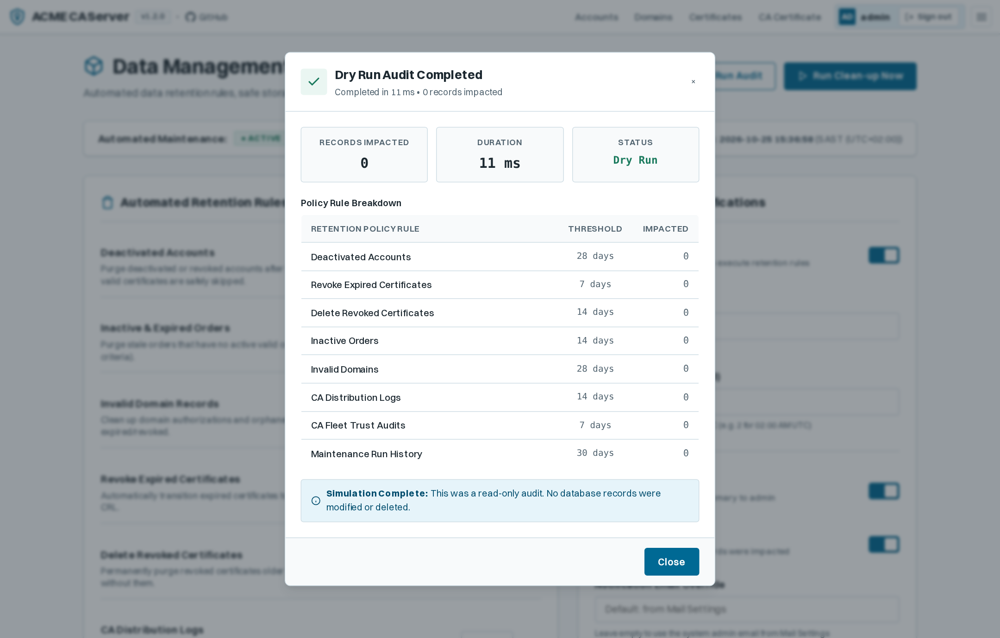

---

### 16. API Trace Live Diagnostic Grid
The **API Trace** diagnostic hub (`/api-trace`) provides comprehensive observability into every inbound ACME protocol interaction, CA/CRL distribution download, and directory request:
- **Live Activity Streaming**: Integrated 5-second polling engine with animated live status pulse dot (`Live (5s)`) displaying incoming requests in real-time.
- **Granular Protocol Columns**: Timestamp with timezone indicator, HTTP method badge (`POST`, `GET`, `HEAD`), HTTP response status code, full endpoint URI path, client IP address, target host header, and round-trip execution latency in milliseconds.
- **Instant Search & Counters**: Filter traces in real-time across endpoints, client IPs, HTTP methods, and target hostnames with active match counters (`Showing X of Y`).
- **Safe Tracing Switch**: Dedicated toggle control to turn API tracing on or off with an irreversible confirmation modal on disable to clear logs.

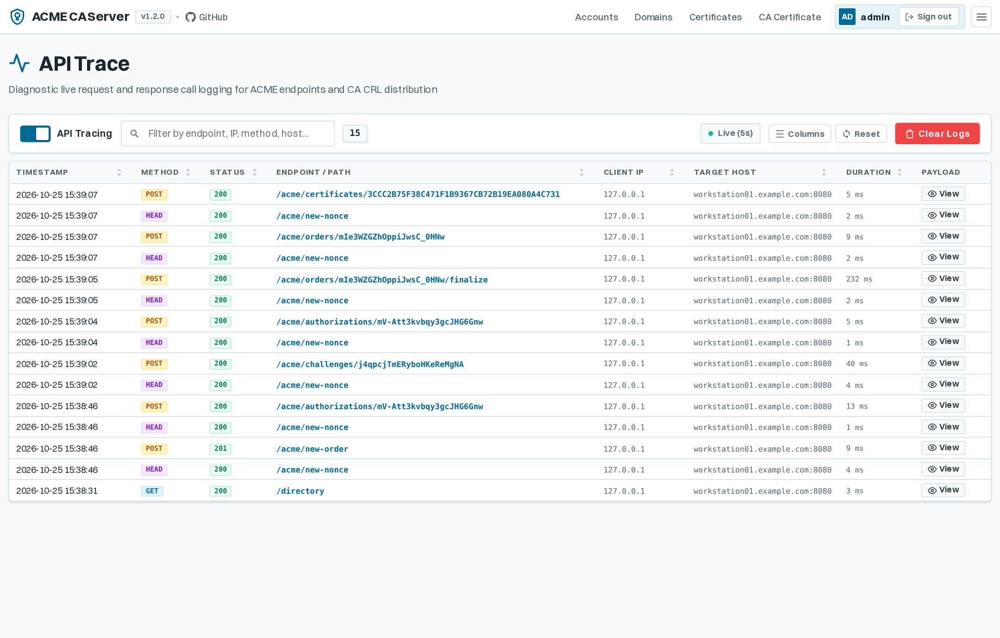

---

### 16b. API Trace Payload & Base64 Decoding Modal
Clicking **View** on any logged API trace opens the high-fidelity inspection dialog with dedicated tabs for **Received (Request)** and **Sent (Response)**:
- **Headers & Payloads**: Inspect raw request headers, request bodies, response headers, and response bodies in scrollable code blocks with 1-click clipboard copy.
- **In-Place Base64 Decoding**: Clicking **[Decode Base64]** unwraps standard ACME JWS signatures (`application/jose+json`) and parses Base64URL-encoded protected headers and payload contents directly into human-readable formatted JSON objects.
- **Bi-Directional Toggle**: The button transitions to **[Show Raw]**, enabling seamless switching back and forth between raw and decoded views without reloading.

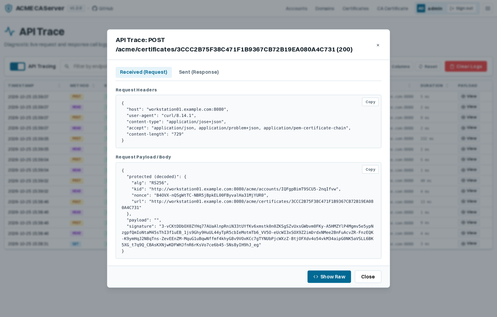

---

### 16c. API Trace X.509 CSR Decoding Modal
When inspecting order finalization requests (`POST /acme/orders/{id}/finalize`), the payload embeds a binary DER Certificate Signing Request (CSR):
- **Dynamic Action Button**: The **[Decode CSR]** button automatically appears when a `"csr"` field is detected in the payload.
- **Cryptographic Deep Inspection**: Powered by server-side Python `cryptography.x509` parsing, it extracts the complete X.509 CSR certificate structure:
  - **Subject Attributes**: Common Name (`CN`), Organization (`O`), Country (`C`), etc.
  - **Subject Alternative Names (SANs)**: Validated DNS names and IP addresses.
  - **Public Key Specifications**: Key algorithm and bit length (e.g. `RSA 2048-bit`, `ECDSA (secp256r1)`).
  - **Signature Verification**: Signature algorithm name and validity check indicator.
  - **PEM Export**: Formatted `-----BEGIN CERTIFICATE REQUEST-----` representation.
- **Interactive Toggle**: Seamlessly switch between the decoded certificate details and the original encoded string via **[Hide CSR]**.

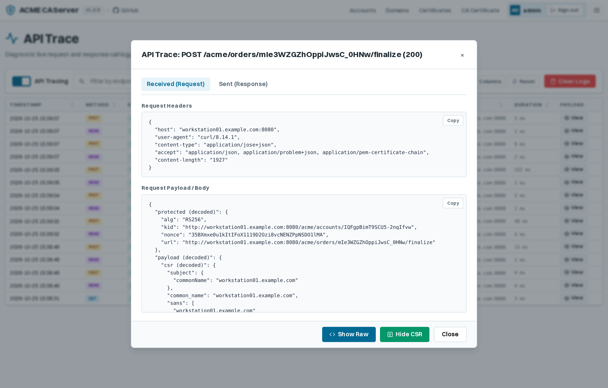


